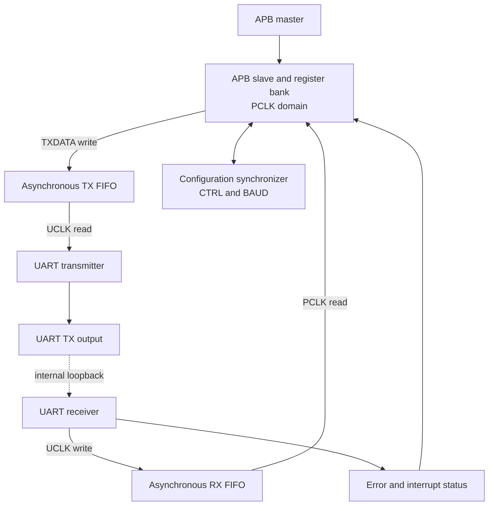
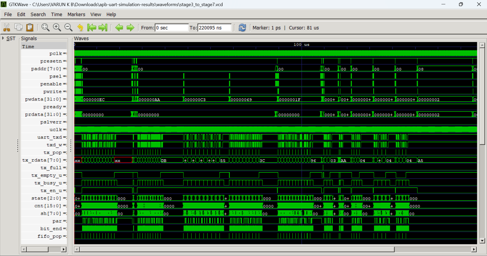
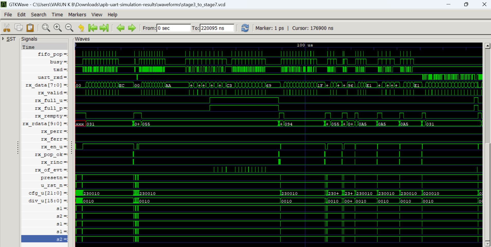

# APB UART FIFO Peripheral


An APB-controlled UART peripheral implemented in Verilog with asynchronous TX/RX FIFOs, configurable UART framing, loopback, status/error reporting and interrupt generation.

> **Project scope:** RTL design and simulation-based verification. This repository does not claim FPGA-board validation, formal verification, CDC sign-off, or fabricated-silicon validation.

## 1. Features

- APB slave interface with a zero-wait-state response (`PREADY = 1`).
- TX and RX asynchronous FIFOs; default FIFO address width is `FIFO_AW = 4`, giving a depth of 16 entries.
- Separate PCLK (APB/register) and UCLK (UART/FIFO-side) clock domains.
- UART transmit and receive logic.
- Configurable baud divisor, parity enable/polarity, one or two stop bits, TX/RX enables and internal loopback.
- Status, interrupt-enable, interrupt-status and sticky error registers.
- Reset deassertion synchronizers for the two clock domains.
- Icarus Verilog regression scripts and GitHub Actions workflow.

## 2. Architecture

The APB register bank and TX FIFO write/RX FIFO read interfaces operate in the PCLK domain. UART TX/RX and the opposite FIFO ports operate in the UCLK domain.



More detail: [`docs/architecture.md`](docs/architecture.md).

## 3. Register map

| Address | Register | Access |
|---:|---|---|
| `0x00` | TXDATA | Write |
| `0x04` | RXDATA | Read |
| `0x08` | CTRL | Read/write |
| `0x0C` | BAUD | Read/write |
| `0x10` | STATUS | Read |
| `0x14` | INTEN | Read/write |
| `0x18` | INTST | Read |
| `0x1C` | ERR | Read/write, write-one-to-clear |

See [`docs/register_map.md`](docs/register_map.md) for bit fields, access behavior and reset values.

## 4. Verification

The verification environment is divided into seven stages. Stage 1, Stage 2 and the combined Stage 3–7 regression are run by `verification/scripts/run_all.sh`.

| Stage | Tests | Focus |
|---|---|---|
| 1 | T1–T10 | Reset, register accesses, TX/RX, loopback, parity/framing, FIFO conditions and interrupt |
| 2 | Procedural APB checker | APB setup/access sequencing, stability, zero-wait response and error-phase legality |
| 3 | T11–T15 | Advanced APB/UART behavior, back-to-back traffic and clock-ratio scenarios |
| 4 | T16–T20 | Pseudo-random loopback, FIFO full/overflow and reset recovery |
| 5 | T21–T24 | Clock-ratio data-integrity tests, RX overflow, contiguous frames and parity |
| 6 | T25–T29 | Framing recovery, APB/RX concurrency, FIFO recovery and invalid accesses |
| 7 | T30 | Two-stop-bit behavior and selected functional event-bin coverage |

### Results recorded in the supplied simulation logs

| Result file | Reported result |
|---|---|
| `results/stage1_results.txt` | 45 checks; `TB RESULT: PASS` |
| `results/stage2_results.txt` | 5 stimulus checks; 88 total checker checks; `APB PROTOCOL RESULT: PASS` |
| `results/advanced_regression_results.txt` | 199 checks; `STAGE 7 REGRESSION RESULT: PASS`; 18/18 selected event bins |

The Stage 7 log reports 100% **selected event-bin coverage**. This is not RTL line/toggle/branch coverage. Stage 2 is a procedural checker, not native SVA or formal verification. CDC tests are simulation stress tests, not formal CDC sign-off.

### GTKWave evidence

The following screenshots are captured from the Stage 3–7 VCD waveform in GTKWave:

#### UART TX and APB activity


#### UART RX and FIFO activity


The VCD files are generated when the simulation scripts run. They are uploaded as GitHub Actions artifacts by the workflow; they are not necessarily committed to the repository.

## 5. Run locally

### Requirements

- Icarus Verilog with SystemVerilog (`-g2012`) support.
- `vvp`.
- GTKWave is optional and is used to inspect VCD waveforms.

### Run all stages

From the repository root:

```bash
bash verification/scripts/run_all.sh
```

Or run an individual stage:

```bash
bash verification/scripts/run_stage1.sh
bash verification/scripts/run_stage2.sh
bash verification/scripts/run_stage3_to_stage7.sh
```

The scripts write logs to `results/`, VCD files to `waveforms/`, and compiled simulation executables to `build/`.

### View a waveform

```bash
gtkwave waveforms/stage3_to_stage7.vcd
```

The exact generated VCD names are defined by the testbenches. If a file is not present, run the corresponding simulation script first.

## 6. Continuous integration

GitHub Actions is configured in [`.github/workflows/apb_uart_ci.yml`](.github/workflows/apb_uart_ci.yml). It installs Icarus Verilog, executes all three regression scripts and uploads `results/` and `waveforms/` as an artifact.

Workflow triggers in the supplied project include pushes and pull requests to `main`/`master`, plus manual dispatch. Check the Actions tab for the result of the latest run.

## 7. Repository layout

```text
APB_UART_FIFO/
├── .github/workflows/apb_uart_ci.yml
├── rtl/apb_uart_rtl.v
├── verification/
│   ├── stage1_basic_functional/tb_basic.sv
│   ├── stage2_apb_protocol/
│   │   ├── apb_assertions.sv
│   │   └── tb_stage2_wrapper.sv
│   ├── stage3_to_stage7_advanced_regression/tb_stage7.sv
│   └── scripts/
├── docs/
├── results/
├── waveforms/
└── README.md
```

## 8. Known design and verification assumptions

- `PREADY` is tied high; the APB checker rule for zero-wait-state behavior is specific to this implementation.
- The 22-bit CTRL/BAUD configuration bus is passed through a two-flop synchronizer. The RTL comments describe this as a quasi-static configuration assumption; it is not a general-purpose coherent multi-bit CDC handshake.
- The RX FIFO stores 10 bits: framing error, parity error and 8-bit received data.
- The receiver checks the first stop bit; the TX supports one or two stop bits.
- The supplied regression evidence is simulation evidence. No physical implementation, timing sign-off, FPGA measurement or silicon result is included here.

## 9. Further documentation

- [Architecture](docs/architecture.md)
- [Register map](docs/register_map.md)
- [Verification plan](docs/verification_plan.md)
- [Design specification](docs/design_specification.md)
- [Implementation notes](docs/implementation_notes.md)
- [Verification summary](results/verification_summary.md)
