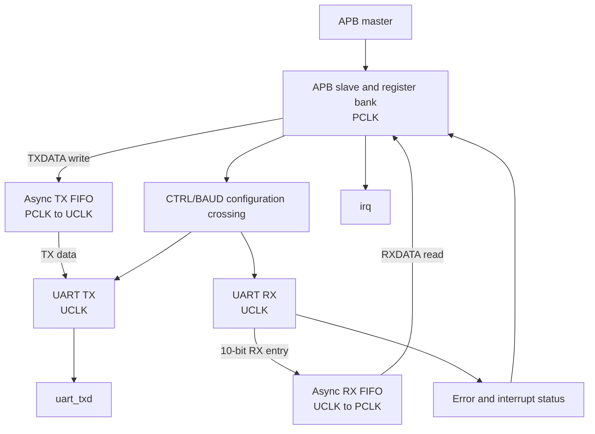

# Architecture

## 1. Top-level overview

The top module is `apb_uart_top` in `rtl/apb_uart_rtl.v`. It contains an APB slave/register bank, asynchronous TX and RX FIFOs, UART transmitter and receiver, configuration/status synchronizers, reset synchronizers, error status and interrupt logic.

The default parameter is `FIFO_AW = 4`; FIFO depth is `2**FIFO_AW = 16` entries.

## 2. Clock domains

| Domain | Main logic |
|---|---|
| `pclk` | APB access/decode, register bank, TX FIFO write port, RX FIFO read port, interrupt/error register logic |
| `uclk` | UART TX/RX, TX FIFO read port, RX FIFO write port |

Both domains use reset deassertion synchronized independently from the asynchronous active-low `presetn` input (`rs_p` and `rs_u` instances).

## 3. Data paths

### TX path

1. An APB write to `TXDATA` (`0x00`) writes the low byte `PWDATA[7:0]` into the TX FIFO in the PCLK domain.
2. The FIFO read side operates in UCLK.
3. The UART transmitter consumes FIFO data when enabled and not empty.
4. The serial output is `uart_txd`.

### RX path

1. The UART receiver samples `uart_rxd` in UCLK, unless internal loopback selects the transmitter output.
2. The RX FIFO stores `{framing_error, parity_error, received_data[7:0]}` (10 bits).
3. The FIFO read side operates in PCLK.
4. An APB read from `RXDATA` (`0x04`) returns the received entry in the low 10 bits of `PRDATA`; an empty read returns zero and sets the RX-underflow sticky error through the RTL logic.

## 4. FIFO and CDC structure

The `async_fifo` module uses binary and Gray-coded pointers, with synchronized Gray-pointer crossings between clock domains. The FIFO uses first-word-fall-through read data. The default depth is 16.

The design also synchronizes:
- The 22-bit `{CTRL, BAUD}` configuration bus into UCLK.
- UART status levels into PCLK.
- RX-overflow event information from UCLK into PCLK using a toggle synchronizer.
- Reset deassertion independently into PCLK and UCLK.

**CDC limitation:** Synchronizing a multi-bit configuration bus with per-bit two-flop synchronizers does not by itself guarantee coherent atomic updates. The RTL comments assume configuration is quasi-static. Treat this as a documented design assumption, not as proof of CDC safety. A production design should consider a handshake or shadow-register/commit mechanism and perform CDC analysis.

## 5. APB behavior

- `PREADY` is continuously asserted (`1`), so the interface is zero-wait-state.
- APB accesses are recognized when `PSEL && PENABLE`.
- Writes are recognized when access and `PWRITE` are high.
- Reads are recognized when access is high and `PWRITE` is low.
- Unmapped addresses and writes to read-only registers assert `PSLVERR`.
- The register map is documented in [`register_map.md`](register_map.md).

## 6. Interrupt and error logic

The three interrupt-status sources are RX-not-empty, TX-empty and any sticky error. `irq` is the bitwise reduction of `int_status & inten`.

The six sticky error bits represent parity, framing, RX overflow, TX overflow, RX underflow and invalid APB access. `ERR` is write-one-to-clear; a simultaneous new error event takes priority over clearing the same bit.

## 7. Architecture diagram

## 8. RTL module inventory

| Module | Responsibility |
|---|---|
| `apb_uart_top` | APB register interface, FIFO connections, configuration/status and interrupt logic |
| `async_fifo` | Dual-clock FIFO with Gray-coded pointers |
| `reset_synchronizer` | Synchronous reset deassertion per clock domain |
| `synchronizer` | Two-stage synchronizer used for selected control/status crossings |
| `uart_tx` | UART serialization, parity and stop-bit generation |
| `uart_rx` | UART sampling, data assembly and parity/framing checks |
